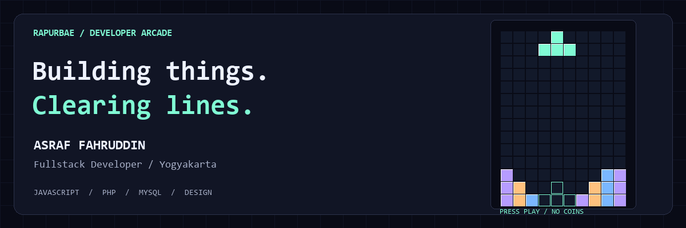

  

<h1 align="center">Asraf Fahruddin</h1>

<strong>Fullstack Developer · Bantul, D.I. Yogyakarta</strong> Building things. Clearing lines.

  

Game sedang menunggu deployment GitHub Pages. Tombol di atas membuka status deployment sementara. Game berjalan di halaman web terpisah, bukan di README GitHub. <a href="assets/tetris-poster.png">Lihat banner statis tanpa animasi</a>

<!-- Ganti tautan tombol dengan alamat game setelah deployment selesai dan URL terverifikasi. -->

## 01 / Meet the player

Fresh graduate **S1 Informatika Universitas Ahmad Dahlan** (2022–2026, IPK 3,45). Saya membangun aplikasi web dari frontend hingga backend: database, API, antarmuka responsif, debugging, dan testing.

Saya juga tertarik pada UI/UX dan desain grafis. **Terbuka untuk peluang kerja.**

## 02 / My loadout

| Area | Tools & skills |
| :--- | :--- |
| Web development | HTML5 · CSS3 · Tailwind CSS · JavaScript · PHP · MySQL · C++ |
| Quality assurance | Software Testing · Functional Testing · Web Application Testing · Debugging · Bug Identification · Troubleshooting |
| Design & creative | Figma · CorelDRAW · Adobe Photoshop · Adobe Illustrator · Blender 3D · Adobe Premiere Pro |
| Editor | Visual Studio Code |

## 03 / Featured quest

### Aplikasi Web DisKominfo Kota Sumedang
**Fullstack Developer · Magang · Sep–Des 2025**

Mengembangkan dan memelihara aplikasi web dari frontend hingga backend, termasuk perancangan arsitektur, database dan API, antarmuka responsif, autentikasi, integrasi layanan pihak ketiga, debugging, testing, dan optimasi performa.

Tech stack dan tautan demo tidak dicantumkan karena belum tersedia pada data portofolio.

## 04 / Experience unlocked

- **Fullstack Developer — Magang**, DisKominfo Kota Sumedang · Sep–Des 2025.
- **Junior Editor Grafis — Magang**, DisKominfo Kota Cirebon · Jun–Jul 2021.
- **Divisi Logistik**, Lembaga Seni Ortonom FTI Universitas Ahmad Dahlan · 2022–2023.

## 05 / Let's connect

[Email](mailto:asraffahruddin741@gmail.com) · [GitHub](https://github.com/rapurbae) · [Repositori portofolio](https://github.com/rapurbae/Portofolio)

---

CODE. STACK. REPEAT. Proyek penggemar independen; tidak berafiliasi dengan The Tetris Company.

